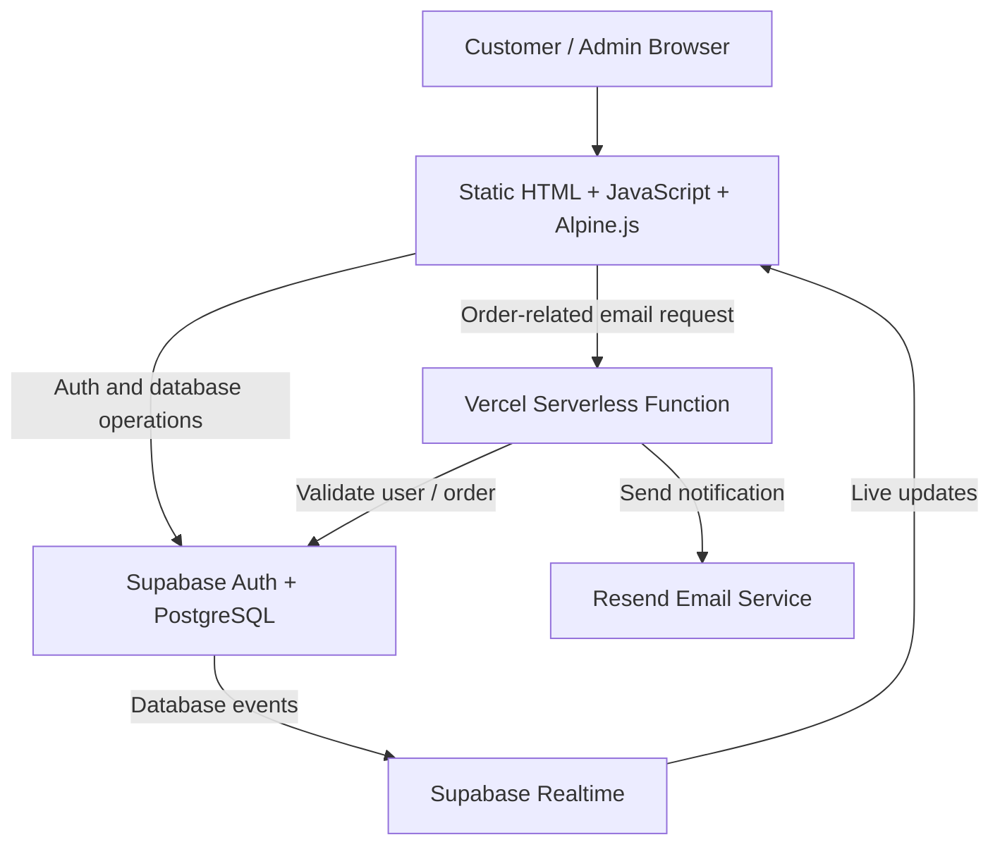

# SnowX ❄️

### Bilingual E-Commerce Platform

**A custom-built digital storefront with a real-time administration experience.**

[**🌐 Visit Live Website**](https://snowx-new.vercel.app/) · [**💼 LinkedIn**](https://www.linkedin.com/in/yasser-alassad/) · [**👨‍💻 Developer Portfolio**](https://yasser-alassad-portfolio.vercel.app/)

**Arabic & English** · **RTL / LTR** · **Serverless Architecture** · **Private Source Code**

---

## Overview

**SnowX** is a personal full-stack web development project: a bilingual storefront for digital products and subscriptions, built without a traditional e-commerce CMS. It combines a multi-page frontend with cloud-hosted authentication, a PostgreSQL database, real-time administrative updates, and serverless email functionality.

The project was designed around two experiences:

- **Customers:** Explore products, manage a cart, apply discount codes, initiate checkout, and review orders.
- **Administrators:** Manage the product catalog, stock, coupons, order statuses, and store settings through a dedicated dashboard.

> **Portfolio showcase:** This public repository documents the project and links to its live deployment. The application source code is intentionally kept private.

## Live Demo

**Website:** https://snowx-new.vercel.app/

The live website illustrates the storefront and customer-facing interface. Administrative features may require an authorized account. Some payment-related interfaces are prototypes or partial integrations; **the project should not be treated as a fully verified end-to-end payment solution**.

## Technology Stack

| Area | Technologies | Purpose |
| --- | --- | --- |
| Frontend | HTML5, CSS3, Vanilla JavaScript (ES6+) | Multi-page application and custom functionality |
| Reactivity | Alpine.js | Interactive state and UI behavior |
| Styling | Tailwind CSS | Responsive styling and RTL/LTR layouts |
| Database | Supabase PostgreSQL | Products, orders, inventory, coupons, and profiles |
| Authentication | Supabase Auth, Google OAuth | Account access and sign-in flows |
| Real-time | Supabase Realtime | Live updates in the admin dashboard |
| Serverless | Vercel Functions (Node.js) | Server-side order-related email handling |
| Email | Resend | Transactional email delivery |
| Deployment | Vercel | Static hosting and serverless execution |

## Key Features

### Customer Experience

- **Bilingual interface:** Arabic and English language switching, with right-to-left and left-to-right layouts.
- **Product catalog:** Browse digital products and available variants.
- **Shopping cart:** Persistent cart state and synchronization across browser tabs using `BroadcastChannel`.
- **Account access:** Email/password authentication and Google sign-in through Supabase Auth.
- **Checkout interface:** Cart review, discount code application, order creation, and payment-method selection.
- **Order history:** Account-based access to previous orders.
- **Email notifications:** An order-related notification flow using Vercel Functions and Resend.

### Admin Experience

- **Order management:** View incoming orders and manage their status.
- **Real-time updates:** Supabase Realtime subscriptions for relevant database changes, reducing manual refreshes.
- **Catalog and inventory tools:** Manage products, variants, and stock levels.
- **Coupons:** Create and maintain percentage-based discount codes.
- **Store administration:** Settings and staff-management interfaces.
- **Dashboard summaries:** Internal order and revenue aggregates.

## Architecture

The frontend is served as static pages on Vercel. The browser communicates with Supabase through its JavaScript client; access is governed by database authorization policies. A Vercel serverless function handles order-related email requests and integrates with Resend.

### Engineering Highlights

- Built an interactive storefront with a **static-first, serverless** architecture.
- Added **Arabic-first UI behavior** and early direction switching to support RTL and LTR layouts.
- Used **database-backed product, inventory, coupon, and order data** instead of a purely static demo.
- Integrated **real-time dashboard updates** using Supabase WebSockets.
- Implemented **cross-tab cart synchronization** using the browser `BroadcastChannel` API.
- Kept server-only email credentials out of the browser application, according to the project's implementation notes.

## Implementation Status & Scope

| Component | Status |
| --- | --- |
| Storefront, bilingual layouts, product browsing | Implemented |
| Account authentication and Google sign-in | Implemented |
| Cart, checkout UI, and order creation | Implemented |
| Coupon and inventory management | Implemented |
| Admin dashboard and real-time order updates | Implemented |
| Order-related confirmation email flow | Implemented; delivery may depend on provider configuration |
| PayPal / card payment interfaces | Partial — no independently verified server-side payment confirmation |
| Automated order fulfillment | Not active; locked pending a server-side admin API |
| Two-factor authentication | Not active |
| Live customer-support chat | UI only |

**Important:** Payment options shown in the interface should not be interpreted as evidence of production-ready payment processing. Server-side verification, payment-provider webhook handling, and related fulfillment controls require further work and testing before real transactions can be considered reliable.

## Screenshots

The gallery below uses screenshots of the project interface. Checkout and administration views are **cropped to omit payment information and customer records**. They are provided to demonstrate the design and implemented workflows, not to certify payment-provider verification.

### Customer Experience

**Homepage — Arabic-first storefront**

**Product Catalog — Browsing digital products**

**Checkout — Cart summary and payment-method selection**

### Administration

**Catalog and Inventory — Admin product management**

**Orders — Admin dashboard overview**

## About This Repository

This repository is intended as a **project showcase and technical case study**, not an open-source distribution of the SnowX application. It contains descriptive documentation and, once added, selected screenshots. The original source code, deployment configuration, database credentials, and private operational details are **not included**.

## Developer

**Yasser Alassad**  
Computer Science Student · Artificial Intelligence Specialization · Effat University

[GitHub](https://github.com/yasser1555) · [LinkedIn](https://www.linkedin.com/in/yasser-alassad/) · [Portfolio](https://yasser-alassad-portfolio.vercel.app/)
